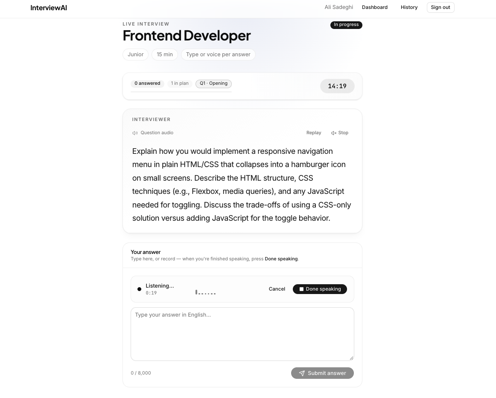
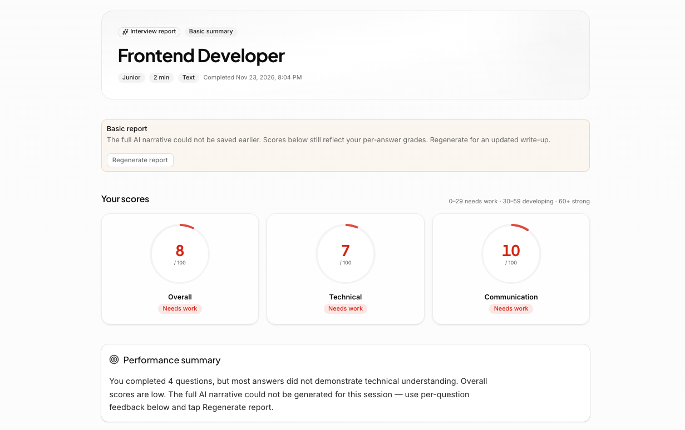
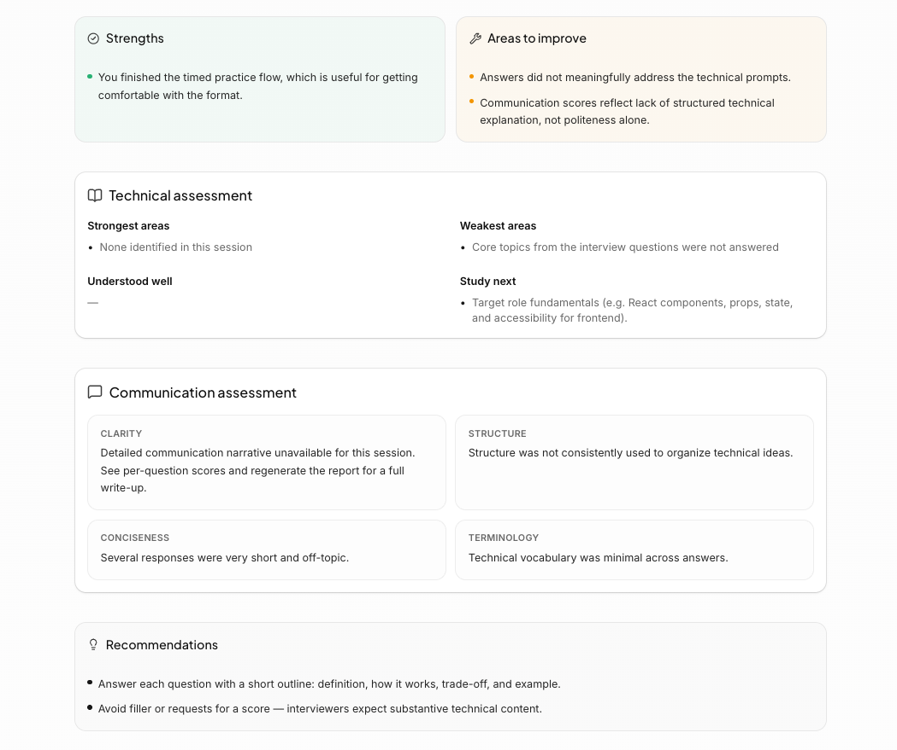

# InterviewAI

AI-powered technical interview practice for developers. Configure a role and level, run a timed session with adaptive questions, answer by **text or voice**, and finish with scores plus a detailed report.

Built as a **Next.js full-stack** app with **Groq**, **AssemblyAI**, **Supabase**, and **Auth.js**.

---

## What you get

- **Authenticated dashboard** — start sessions, view history, delete past runs
- **Interview workspace** — live timer, adaptive questions (Groq), per-answer evaluation
- **Hybrid input** — type or record each answer; voice is transcribed before grading
- **Question TTS** — optional read-aloud with synchronized highlighting
- **Final report** — overall, technical, and communication scores; strengths, gaps, and study tips
- **Unit tests** — Jest coverage for core `src/lib` helpers (`pnpm test`)

---

## Screenshots

### Live interview workspace

Timed session with question audio, hybrid text/voice answering, and progress tracking.



### Report overview

Session scores and high-level performance summary after completion.



### Detailed feedback

Structured breakdown of strengths, technical and communication assessments, and recommendations.



---

## How it works

1. **Sign up / log in** (email + password or Google OAuth).
2. **Configure** role (frontend, backend, full-stack), level, duration, and start a session.
3. **Interview** — answer one question at a time; the AI scores each response and picks the next question.
4. **Complete** when time runs out (or abandon); open the **report** for scores and narrative feedback.

Questions are **adaptive**: difficulty and follow-ups depend on your answers, role, level, and remaining time.

---

## Tech stack

| Layer | Tools |
| ----- | ----- |
| Framework | [Next.js 16](https://nextjs.org/) (App Router), React 19, TypeScript |
| UI | Tailwind CSS 4, [shadcn/ui](https://ui.shadcn.com/) (Base UI), Lucide icons |
| Data | [Prisma](https://www.prisma.io/) + PostgreSQL on [Supabase](https://supabase.com/) |
| Auth | [Auth.js](https://authjs.dev/) (NextAuth v5) — credentials + Google |
| AI | [Groq](https://groq.com/) (questions, evaluation, final report) |
| Speech | Browser Speech Synthesis (questions), [AssemblyAI](https://www.assemblyai.com/) (answer transcription) |
| Validation | Zod, React Hook Form |
| Tests | Jest + ts-jest |

---

## Getting started

### Prerequisites

- Node.js 20+
- [pnpm](https://pnpm.io/) 11+
- Supabase project (Postgres + connection strings)
- Groq API key
- AssemblyAI API key (for voice answers)
- Google OAuth credentials (optional, for “Sign in with Google”)

### Install and run

```bash
pnpm install
cp .env.example .env
```

Edit `.env` (see below), then:

```bash
pnpm db:migrate   # or pnpm db:push in early setup
pnpm dev
```

Open [http://localhost:3000](http://localhost:3000).

### Production build

```bash
pnpm build
pnpm start
```

---

## Environment variables

| Variable | Purpose |
| -------- | ------- |
| `DATABASE_URL` | Postgres (Supabase **transaction** pooler, usually port **6543**) |
| `DIRECT_URL` | Postgres **direct** URL for Prisma migrations (port **5432**) |
| `AUTH_SECRET` | Session signing — generate with `openssl rand -base64 32` |
| `GROQ_API_KEY` | Groq API access |
| `GROQ_MODEL` | Model id (e.g. `openai/gpt-oss-120b`) |
| `ASSEMBLYAI_API_KEY` | Speech-to-text for voice answers |
| `GOOGLE_CLIENT_ID` | OAuth (optional) |
| `GOOGLE_CLIENT_SECRET` | OAuth (optional) |

For local Google OAuth, add redirect URI:  
`http://localhost:3000/api/auth/callback/google`

Never commit real secrets. Use placeholder values in `.env.example` only.

---

## Scripts

| Command | Description |
| ------- | ----------- |
| `pnpm dev` | Development server |
| `pnpm build` | Production build |
| `pnpm start` | Run production server |
| `pnpm lint` | ESLint |
| `pnpm test` | Jest unit tests |
| `pnpm db:generate` | `prisma generate` |
| `pnpm db:migrate` | `prisma migrate dev` |
| `pnpm db:push` | Push schema without migration files |
| `pnpm db:studio` | Prisma Studio |

---

## Repository layout (high level)

```
src/
  app/              # Routes (marketing, auth, dashboard, interview API)
  components/       # UI, interview workspace, reports
  lib/              # AI schemas, validations, interview timing, speech helpers
  services/         # Interview session business logic
  hooks/            # Voice recording, question speech, etc.
prisma/             # Schema and migrations
public/             # Static assets (landing screenshots, etc.)
```

---

## Deploying

`main` is the deploy branch. On [Vercel](https://vercel.com/) (or similar):

1. Connect the repo and set the same environment variables as `.env`.
2. Set production `AUTH_SECRET` and database URLs from Supabase.
3. Add production Google OAuth callback:  
   `https://<your-domain>/api/auth/callback/google`
4. Run migrations against production (`pnpm db:migrate` in CI or locally with `DIRECT_URL`).

---

## License

Private project (`"private": true` in `package.json`). All rights reserved unless you publish otherwise.